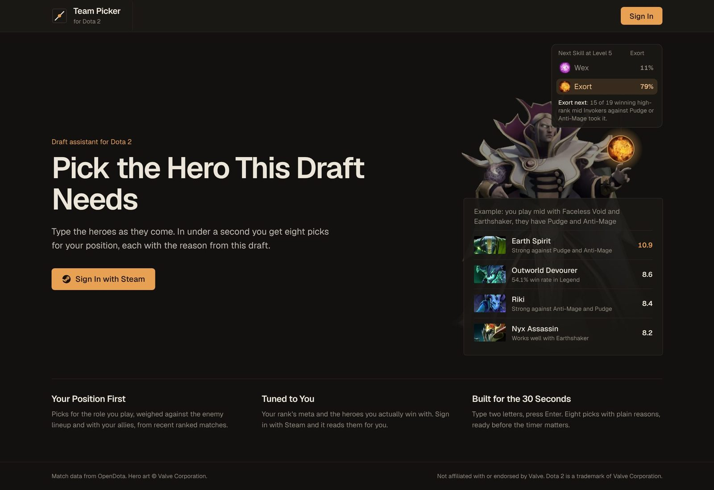

<div align="center">


# Dota 2 Team Picker

**Pick the hero this draft needs.**<br>
Type the heroes as they come. In under a second you get eight picks for your position,<br>
each with the reason from this draft.

[](https://dota2-team-picker-web.vercel.app)
[](https://github.com/MCantuncer/dota2-team-picker-web/actions/workflows/ci.yml)
[](https://github.com/MCantuncer/dota2-team-picker-web/actions/workflows/e2e.yml)
[](https://github.com/MCantuncer/dota2-team-picker-web/actions/workflows/codeql.yml)

[](https://nextjs.org)
[](https://react.dev)
[](https://www.typescriptlang.org)
[](https://tailwindcss.com)
[](https://supabase.com)
[](https://vercel.com)

<a href="https://dota2-team-picker-web.vercel.app"></a>

</div>

## What You Get

| Feature | What It Does |
| --- | --- |
| **Draft Room** | Eight picks for your position, recalculated every round, each with a reason that names this draft's heroes and real numbers. |
| **Watch Dota** | Press PrtScn in Dota and paste: both teams and the bans fill in by themselves. |
| **My Heroes** | Your hero pool per position, filled from your Steam games, with a Top 3 that the picks lean on. |
| **Party and Stacks** | Draft with friends and plan the whole lineup's picks together. |
| **Game Story** | After the game: items, skills and the full talent tree for your hero, against this enemy lineup. |
| **Steam Sign-In** | One click, no password. Your rank and hero record are read for you. |

## Quick Start

```sh
cp .env.example .env.local   # fill in your Supabase URL and publishable key
npm install
npm run dev                  # http://localhost:3000
```

Accounts run on Supabase. Set them up first with the
[accounts README](https://github.com/MCantuncer/dota2-team-picker/tree/main/services/accounts) in the backend repo.

## Where Things Live

| Path | What Is There |
| --- | --- |
| [`src/app`](src/app) | Pages (Next.js App Router) |
| [`src/lib/engine`](src/lib/engine) | The scoring engine, copied from the [backend repo](https://github.com/MCantuncer/dota2-team-picker) |
| [`src/app/globals.css`](src/app/globals.css) | Design tokens and shared classes, see the [design system](docs/design-system.md) |
| [`e2e`](e2e) | Playwright browser tests with accessibility checks |
| [`docs/development.md`](docs/development.md) | Tests, backend copies, CI and deploying to Vercel |

## Contributing

Read [CONTRIBUTING.md](CONTRIBUTING.md) before opening a pull request: it holds the code standards and the checklist
every change follows.

<sub>Match data from OpenDota and STRATZ. Hero art © Valve Corporation. Not affiliated with or endorsed by Valve.
Dota 2 is a trademark of Valve Corporation.</sub>
